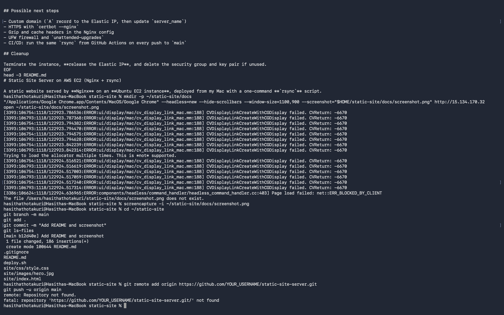

# Static Site Server on AWS EC2 (Nginx + rsync)

A static website served by **Nginx** on an **Ubuntu EC2 instance**, deployed from my Mac with a one-command **`rsync`** script.

This is my solution to the [Static Site Server](https://roadmap.sh/projects/static-site-server) project on roadmap.sh.



## Architecture

```
 MacBook                         AWS (region: ap-southeast-2)
┌──────────────┐   rsync over   ┌─────────────────────────────────┐
│ site/ folder │ ─────SSH────▶  │ EC2 t3.micro (Ubuntu LTS)       │
│ deploy.sh    │                │  └─ Nginx → /var/www/mysite     │
└──────────────┘                │ Elastic IP + Security Group     │
                                └───────────────▲─────────────────┘
                                                │ HTTP :80
                                             Browser
```

## Repository layout

```
.
├── README.md
├── deploy.sh              # rsync deploy script
├── docs/screenshot.png    # screenshot of the live site
└── site/
    ├── index.html
    ├── css/style.css
    └── images/hero.jpg
```

## Requirements checklist

| Requirement | How it's met |
|---|---|
| Remote Linux server | EC2 `t3.micro`, Ubuntu Server LTS |
| SSH access | Key pair (`.pem`) plus a `static-server` alias in `~/.ssh/config` |
| Nginx serving a static site | Custom server block, `/var/www/mysite` as web root |
| HTML, CSS and image files | `index.html`, `css/style.css`, `images/hero.jpg` |
| `rsync` deploys | `deploy.sh` |
| Served from the server's IP | Elastic IP attached to the instance |

## Setup

### 1. Launch the instance

- AMI: Ubuntu Server (LTS), instance type: `t3.micro`
- Key pair: RSA, `.pem` format
- Security group inbound rules:

  | Port | Source | Why |
  |---|---|---|
  | 22 (SSH) | my public **IPv4** `/32` | admin access only |
  | 80 (HTTP) | `0.0.0.0/0` | the website |
  | 443 (HTTPS) | `0.0.0.0/0` | reserved for TLS later |

- Allocate an **Elastic IP** and associate it with the instance so the address survives stop/start.

### 2. Configure SSH on the Mac

```bash
mv ~/Downloads/static-site-key.pem ~/.ssh/
chmod 400 ~/.ssh/static-site-key.pem
```

Add to `~/.ssh/config`:

```
Host static-server
    HostName <ELASTIC_IP>
    User ubuntu
    IdentityFile ~/.ssh/static-site-key.pem
    IdentitiesOnly yes
    ServerAliveInterval 30
    ServerAliveCountMax 4
```

```bash
ssh static-server
```

### 3. Install and configure Nginx (on the server)

```bash
sudo apt update && sudo apt install -y nginx
sudo mkdir -p /var/www/mysite
sudo chown -R ubuntu:ubuntu /var/www/mysite   # lets rsync write without sudo
```

`/etc/nginx/sites-available/mysite`:

```nginx
server {
    listen 80;
    listen [::]:80;
    server_name _;

    root /var/www/mysite;
    index index.html;

    location / {
        try_files $uri $uri/ =404;
    }
}
```

Enable it, remove the default site, validate, reload:

```bash
sudo ln -s /etc/nginx/sites-available/mysite /etc/nginx/sites-enabled/
sudo rm /etc/nginx/sites-enabled/default
sudo nginx -t
sudo systemctl reload nginx
```

### 4. Deploy

```bash
./deploy.sh --dry-run   # preview what would change
./deploy.sh             # upload
```

## `deploy.sh`

```bash
#!/usr/bin/env bash
set -euo pipefail

SERVER="${DEPLOY_HOST:-static-server}"        # alias from ~/.ssh/config
REMOTE_DIR="/var/www/mysite/"
LOCAL_DIR="$(cd "$(dirname "$0")" && pwd)/site/"

echo "Deploying $LOCAL_DIR -> $SERVER:$REMOTE_DIR"

rsync -avz --delete \
  --exclude '.DS_Store' \
  "$@" \
  "$LOCAL_DIR" "$SERVER:$REMOTE_DIR"

echo "Done."
```

- The trailing `/` on `site/` copies the folder's *contents*. Without it, files land in `/var/www/mysite/site/`.
- `--delete` makes the server mirror the local folder exactly, so I always preview with `--dry-run` first.
- Extra flags pass straight through to `rsync` via `"$@"`.
- Re-running with no changes transfers almost nothing, because `rsync` only sends differences.

## Verify

```bash
curl -s http://<ELASTIC_IP> | head -5
ssh static-server 'systemctl is-active nginx'
```

Edit `site/index.html`, run `./deploy.sh`, refresh the browser. The change should appear without touching the server.

## Security notes

- SSH is limited to a single `/32` source address, never `0.0.0.0/0`.
- Password logins are off by default on Ubuntu EC2 images, so access is key-only.
- The `.pem` file lives in `~/.ssh` with mode `400` and is **never committed**. Add `*.pem` to `.gitignore`.
- OS security updates applied with `apt upgrade`, followed by a reboot for the new kernel.

## Lessons learned

1. **SSH timeouts usually mean the security group, not the key.** My rule was created from the console's "My IP" button, which captured an **IPv6** address, so my IPv4 connection never matched. I fixed it with `curl -4 -s https://checkip.amazonaws.com` and a manual `x.x.x.x/32` rule.
2. **Home and mobile IPs change.** After switching networks the rule went stale and `deploy.sh` timed out. The fix was to update the rule.
3. **Use an Elastic IP.** Otherwise the public IP changes on every stop/start and breaks the SSH config and any DNS. AWS bills for public IPv4 addresses, so release it when finished.
4. **Check config edits that append to files.** Appending to `~/.ssh/config` with `cat >>` glued my entry onto a last line with no trailing newline. `ssh -G <host>` showed the effective settings and exposed it.
5. **The browser can cache the old page.** `curl` and private windows showed the real state.
6. **`deploy.sh` runs on the Mac, not on the server.**

## Possible next steps

- Custom domain (`A` record to the Elastic IP, then update `server_name`)
- HTTPS with `certbot --nginx`
- Gzip and cache headers in the Nginx config
- UFW firewall and `unattended-upgrades`
- CI/CD: run the same `rsync` from GitHub Actions on every push to `main`

## Cleanup

Terminate the instance, **release the Elastic IP**, and delete the security group and key pair if unused.
